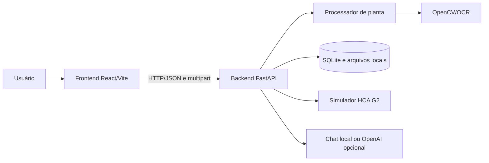
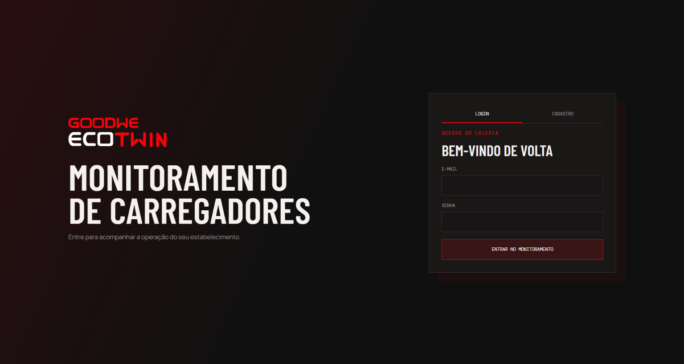
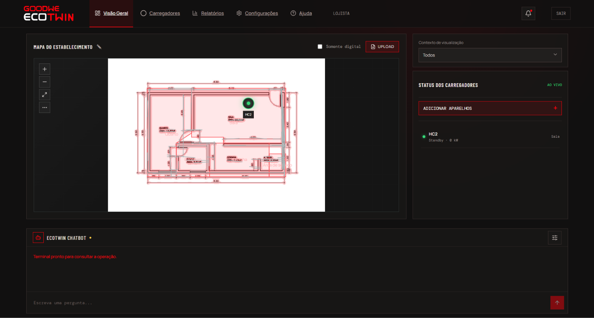
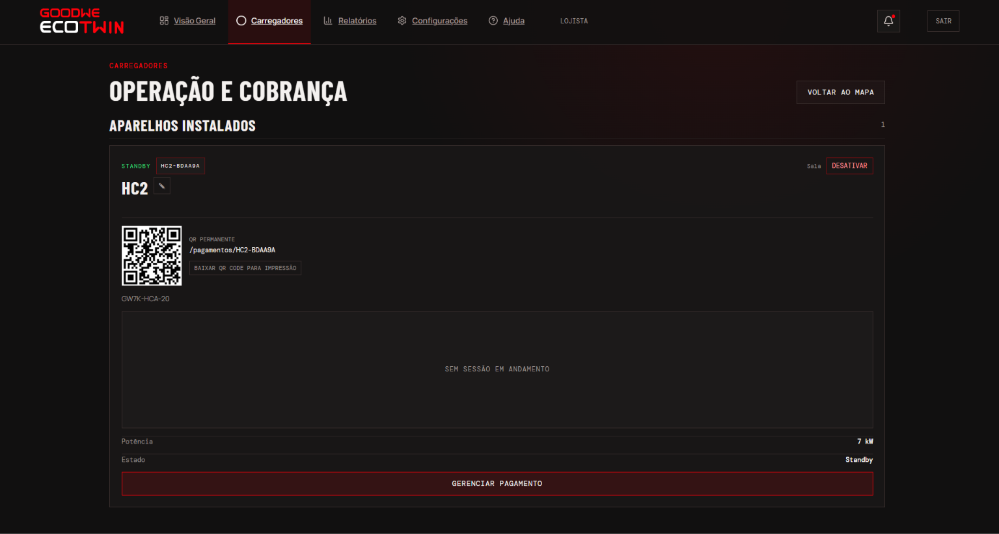
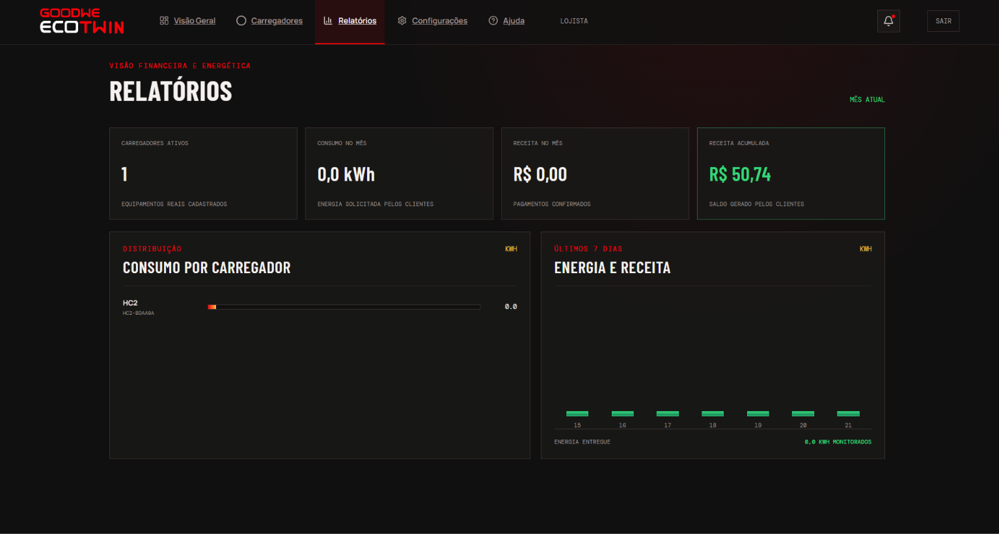

# GoodWe EV Solution

## Integrantes

**Turma:** 1CCPW

- Aneliza Rondina — RM572977
- Arthur Costa — RM569976
- Guilherme Detta — RM569666
- Henrique Bolfer — RM569514
- Igor Alves — RM574127
- Rafaella Ferreira — RM571030

## Descrição e objetivo

O projeto é um protótipo de gestão e monitoramento de carregadores de veículos elétricos GoodWe. A solução recebe uma planta baixa, transforma o desenho em um mapa digital, permite posicionar carregadores e acompanha telemetria, sessões, alarmes, pedidos de recarga e pagamentos.

O objetivo da Sprint 3 é integrar a visualização operacional do estabelecimento ao backend, com dados simulados compatíveis com o carregador HCA G2 e uma página pública acessível pelo código permanente do carregador.

## Tecnologias

- **Frontend:** React 19, Vite, React Router, Lucide React e QRCode.
- **Backend:** Python, FastAPI, Uvicorn, Pydantic, SQLite, OpenCV, NumPy, Pillow e Pytesseract.
- **Testes:** Pytest, FastAPI TestClient e HTTPX.
- **Dados e referência técnica:** SQLite local, JSON de treinamento, datasheet, manual e mapa MODBUS do HCA G2.

## Estrutura da solução

```text
goodwe-ecotwin/
├── backend/       API FastAPI, processamento de plantas, banco e testes
├── frontend/      aplicação React para monitoramento e operação
├── docs/          PDFs do desafio e documentação técnica do HCA G2
├── .gitignore     regras únicas para arquivos locais e gerados
└── README.md      documentação única da solução
```

### Backend

O backend está em `backend/app` e expõe a API em `http://127.0.0.1:8000`. O processamento usa OpenCV para detectar áreas e paredes da planta e Pytesseract quando o OCR está disponível. O SQLite e os arquivos gerados ficam em `backend/data` durante o desenvolvimento.

A aplicação segue uma organização MVC adaptada ao FastAPI:

- `app/controllers/` contém os routers HTTP separados por contexto;
- `app/services/` concentra os casos de uso e regras de negócio;
- `app/schemas/` contém os modelos Pydantic divididos por domínio;
- `app/repositories/` expõe a fronteira de persistência local;
- `app/core/` reúne configuração e dependências da aplicação.

`app/main.py` funciona somente como composition root: cria a aplicação, configura CORS e registra os routers. O processamento de imagens e o simulador de telemetria permanecem como serviços técnicos independentes.

Principais recursos:

- cadastro e login de usuários;
- upload e processamento de plantas em PNG, JPEG, WEBP ou BMP;
- criação, atualização e exclusão de dispositivos e carregadores;
- telemetria simulada, histórico, sessões e alarmes;
- pedidos de recarga e créditos de carteira;
- página pública do carregador em `/pagamentos/{codigo}`;
- ECOTWIN Chatbot com respostas locais ou OpenAI configurada no backend.

### Frontend

O frontend está em `frontend/src` e é servido pelo Vite em `http://localhost:5173`. A interface oferece autenticação, upload da planta, mapa interativo, posicionamento de carregadores, painel de status, alertas, QR Code e chatbot.

### Documentação

`docs/` contém os materiais fornecidos para o desafio, incluindo o datasheet, manual e mapa MODBUS do HCA G2. Esses arquivos são referências técnicas e não são necessários para iniciar os servidores.

## Arquitetura e integração



O frontend envia a planta para `POST /api/plans`, recebe o mapa vetorial e consulta os carregadores por HTTP. O backend persiste planos e telemetria localmente.

A simulação gera estados, potência, tensão, corrente, energia, temperatura e falhas. O campo `source` identifica os dados como `mock`, deixando a troca futura por MODBUS TCP ou OCPP explícita.

## Fluxo de funcionamento

1. O usuário cria uma conta ou entra no sistema.
2. O frontend envia uma imagem de planta ao backend.
3. O backend identifica áreas e paredes, cria o mapa e retorna o `plan_id`.
4. O usuário posiciona carregadores e outros dispositivos no mapa.
5. O backend gera a telemetria simulada e registra histórico e alarmes.
6. A interface atualiza os dados periodicamente e permite consultar sessões, pedidos e pagamentos.
7. O código permanente de um carregador abre sua página pública de status e QR Code.

## Resultados funcionais

Os testes existentes validam:

- resposta de saúde da API;
- rejeição de arquivos que não são imagens;
- upload de planta e inclusão de dispositivo;
- telemetria e histórico de carregador;
- acesso público ao ChargeGrid e CORS do frontend;
- unicidade do código de carregador real e exclusão confirmada;
- detecção de vagas em uma planta desenhada.

Os dados de telemetria são simulados e não representam conexão real com um equipamento. O repositório não contém métricas de produção ou resultados quantitativos além dos comportamentos cobertos pelos testes.

## Relação com a disciplina

O projeto aplica desenvolvimento web full stack, integração entre componentes por API REST, persistência de dados, testes automatizados, processamento de imagens, modelagem de domínio e organização de uma solução com frontend, backend e documentação separados.

As decisões sobre potência, tensão, estados e registradores são baseadas nos documentos técnicos do HCA G2 presentes em `docs/`.

## Como executar

### Pré-requisitos

- Python 3.11 ou superior;
- Node.js e npm;
- Git;
- Tesseract OCR opcional para habilitar o reconhecimento de texto da planta.

### 1. Backend

No PowerShell, a partir da pasta `goodwe-ecotwin`:

```powershell
cd backend

py -m venv .venv

.\.venv\Scripts\Activate.ps1

python -m pip install -r requirements.txt

uvicorn app.main:app --reload --port 8000
```

API e documentação interativa:

- `http://127.0.0.1:8000/health`
- `http://127.0.0.1:8000/docs`

Para ativar o chatbot com OpenAI, copie `backend/.env.example` para `backend/.env` e preencha a chave. Sem a chave, o modo local continua funcionando.

### 2. Frontend

Em outro terminal, a partir de `goodwe-ecotwin`:

```powershell
cd frontend

npm install

npm run dev
```

Abra `http://localhost:5173`.

Para validar a versão de produção:

```powershell
npm run build

npm run preview
```

### 3. Testes e lint

Com o ambiente virtual do backend ativado:

```powershell
cd backend

python -m pytest
```

No frontend:

```powershell
cd frontend

npm run lint
```

## Controle de arquivos locais

O `.gitignore` da raiz ignora ambientes virtuais, dependências do npm, caches, builds, banco SQLite local, planos gerados, arquivos `.env` e arquivos de editor.

O ambiente virtual usado pelo backend fica em `backend/.venv` e nunca deve ser enviado ao GitHub.

Arquivos `.env.example` permanecem versionáveis como modelo sem segredos.

## Imagens e prints do protótipo

As principais telas do protótipo estão apresentadas abaixo:

### Login

Tela de login do sistema, usada para autenticar os usuários.



### Home

Página inicial com as funções centrais da solução, incluindo o chatbot, o cadastro de carregadores HCA e o Digital Twin.



### Operação e cobrança

Tela para monitorar os dados do carregador, consultar o QR Code e gerenciar pagamentos.



### Relatórios

Tela com uma visão geral dos dados, da receita e das informações monetárias da operação.


